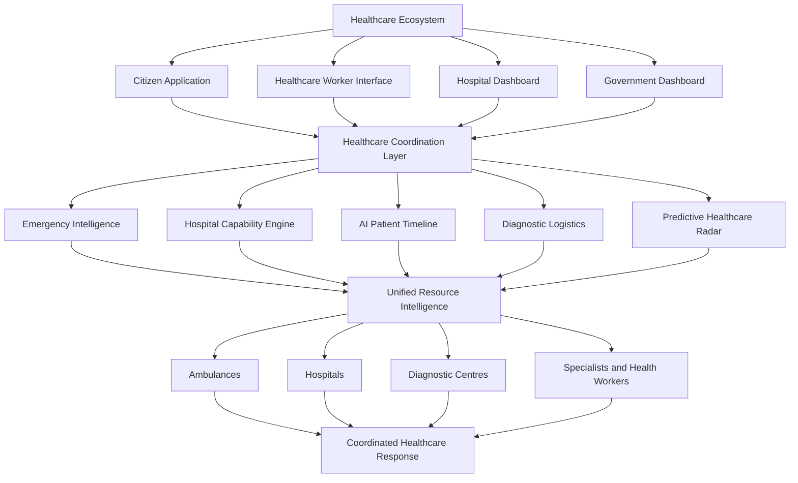

# JEEVAN-NET
### India's Intelligent Healthcare Response Network

**From Symptom to Solution — Before It's Too Late.**

  <strong>An AI-powered healthcare orchestration platform connecting patients, healthcare workers, ambulances, diagnostic centres, specialists and hospitals through intelligent coordination.</strong>

---

## 1. Overview

Healthcare systems often have the resources needed to save lives, yet patients may still experience delays because those resources are fragmented, difficult to locate or poorly coordinated.

A patient may need an ambulance, but not every ambulance has the required equipment. The nearest hospital may not have the necessary specialist, ICU capacity or diagnostic facilities. Medical information may be scattered across multiple providers, making timely decisions difficult.

**JEEVAN-NET** addresses this coordination gap.

It is a software-first, AI-powered healthcare intelligence and orchestration platform designed to connect existing healthcare infrastructure into a coordinated response network.

Rather than functioning as another standalone healthcare application, JEEVAN-NET focuses on answering four critical questions:

- What healthcare assistance does the patient need?
- Where is the required medical capability available?
- How quickly can that capability be reached?
- What should happen next?

Our vision is to help transform healthcare delivery from fragmented and reactive processes into a coordinated, predictive and resource-aware ecosystem.

## 2. The Problem We Are Solving

Healthcare delivery faces several interconnected challenges:

| Challenge | Existing Gap |
|---|---|
| Emergency response delays | Difficulty identifying the right ambulance and capable hospital |
| Rural healthcare accessibility | Limited access to specialists and advanced facilities |
| Specialist shortages | Uneven distribution and utilization of medical expertise |
| Diagnostic delays | Inefficient coordination between patients and diagnostic centres |
| Fragmented patient records | Medical information distributed across different providers |
| Ambulance inefficiency | Limited coordination between ambulance capability and hospital readiness |
| Hospital overcrowding | Poor visibility into resource availability and patient flow |
| Blood availability | Difficulty anticipating regional demand and supply gaps |
| Chronic disease management | Delayed identification of worsening health trends |
| Public-health monitoring | Difficulty identifying emerging patterns across healthcare facilities |

The central issue is not always the absence of healthcare infrastructure. It is often the absence of an intelligent system coordinating the infrastructure that already exists.

## 3. Our Solution

JEEVAN-NET introduces an intelligent coordination layer across the healthcare ecosystem.

The platform combines AI-assisted analysis, resource matching, geospatial intelligence, predictive monitoring and human-in-the-loop workflows.

### Core Operating Philosophy

**CONNECT → UNDERSTAND → ACT**

1. **CONNECT:** Connect patients, health workers, doctors, hospitals, ambulances, laboratories and blood banks.
2. **UNDERSTAND:** Evaluate patient needs, urgency, medical history, geographical accessibility and available healthcare resources.
3. **ACT:** Recommend suitable care pathways, coordinate resources, facilitate clinical handoffs and initiate follow-up workflows.

The platform uses specialized intelligence engines instead of depending on one generic chatbot.

## 4. Key Features & Intelligence Modules

### A. Emergency Intelligence

An emergency coordination engine that evaluates the patient's requirements and identifies suitable healthcare destinations.

Key capabilities:
- Emergency severity assessment support.
- Capability-aware hospital matching.
- Ambulance suitability evaluation.
- Travel-time and resource consideration.
- Hospital pre-alert and clinical handoff generation.

**Core innovation:** The system prioritizes the nearest suitable hospital, not simply the nearest hospital.

### B. Hospital Capability Map

A geospatial healthcare resource intelligence layer that represents hospitals and healthcare facilities based on their capabilities.

Potential parameters include:
- Bed and ICU availability.
- Specialist availability.
- CT and other diagnostic facilities.
- Operation theatre availability.
- Blood availability.
- Ambulance and emergency support.

This enables capability-based resource matching rather than distance-only recommendations.

### C. AI Patient Timeline

A consent-based patient information management module that organizes permitted health records into a chronological timeline.

Key capabilities:
- Medical history summarization.
- Diagnosis and medication timelines.
- Identification of relevant health trends.
- Concise clinical briefing generation.
- Structured information handoff between healthcare providers.

### D. Diagnostic Logistics Intelligence

A diagnostic coordination engine designed to identify appropriate diagnostic pathways using:

- Diagnostic availability.
- Geographic distance.
- Expected turnaround time.
- Clinical urgency.
- Estimated cost.

The objective is to reduce unnecessary delays and improve diagnostic accessibility.

### E. Predictive Healthcare Radar

A predictive intelligence module designed to identify potential healthcare bottlenecks and emerging resource requirements.

Potential applications:
- Blood demand forecasting.
- Hospital resource bottleneck alerts.
- Chronic-care follow-up signals.
- Regional healthcare demand monitoring.
- Public-health anomaly detection.

Predictions are intended to support investigation and operational planning, not replace professional judgment.

## 5. System Architecture

JEEVAN-NET follows a modular architecture consisting of specialized intelligence engines connected through a common coordination layer.

### Architectural Principles

- **Modularity:** Independent intelligence engines for different healthcare workflows.
- **Interoperability:** Designed to leverage existing public digital-health infrastructure rather than duplicate it.
- **Scalability:** Architecture designed to expand from individual facilities to district, state and national deployments.
- **Human-in-the-loop:** AI supports prioritization and coordination while authorized healthcare professionals retain clinical decision-making authority.
- **Privacy-first:** Consent-based access and privacy-preserving information handling.
- **Resilience:** Offline-first workflows with queued synchronization for weak-network environments.

## 6. MVP — What We Are Building

The initial implementation focuses on five high-impact modules.

| Module | Primary Demonstration |
|---|---|
| Emergency Intelligence | Emergency → triage support → ambulance → hospital |
| Hospital Capability Map | Healthcare resource and capability matching |
| AI Patient Timeline | Consent-based record summarization |
| Diagnostic Logistics | Appropriate diagnostic pathway optimization |
| Predictive Healthcare Radar | Bottleneck, blood and operational alerts |

The MVP prioritizes a demonstrable end-to-end emergency coordination workflow while establishing the foundation for additional healthcare intelligence modules.

## 7. The Winning Demonstration Scenario

### Case Study: Suspected Stroke Emergency

**Scenario:** A 58-year-old male presents with symptoms indicating a possible stroke.

Traditional healthcare coordination may involve multiple independent calls, repeated referrals and delays in identifying a suitable facility.

JEEVAN-NET demonstrates an integrated alternative.

**Proposed workflow:**

1. An emergency request is initiated.
2. The emergency risk pathway is activated.
3. Suitable ambulances are evaluated.
4. Stroke-capable hospitals are identified.
5. CT scan availability is checked.
6. Neurologist availability is considered.
7. Travel time and facility capacity are evaluated.
8. A suitable destination is recommended.
9. The receiving hospital is
